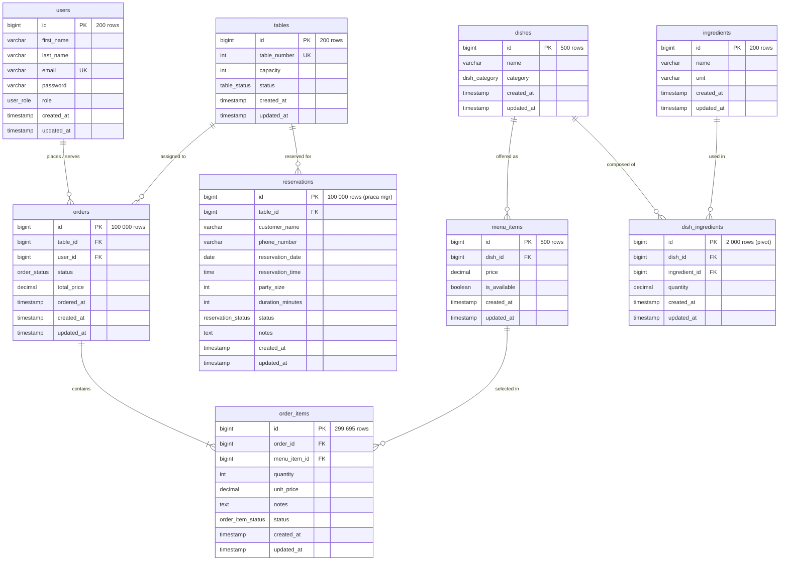

# Dokumentacja Bazy Danych (PostgreSQL 16) — Benchmark REST API

Niniejszy dokument przedstawia pełną specyfikację relacyjnej bazy danych **PostgreSQL 16** wykorzystywanej w empirycznym badaniu porównawczym wydajności frameworków **Laravel 13 (PHP 8.4)** oraz **NestJS 11 (Node.js 24 LTS)**.

Baza danych modeluje realistyczny system zarządzania restauracją (POS / Restaurant Management System), obejmując tabele słownikowe, asocjacyjne oraz transakcyjne o łącznym wolumenie od **401 895 do 501 895 rekordów** (w zależności od wariantu badania).

---

> ### 📌 Rozróżnienie Zakresu Badania: Artykuł Naukowy vs Praca Magisterska
> 
> W repozytorium występuje celowe rozróżnienie pomiędzy zakresem bazy danych raportowanym w **8-stronicowym artykule naukowym** a pełnym zakresem zaimplementowanym w bazie pod **pracę magisterską**:
> 
> | Wymiar | Artykuł Naukowy (8 stron, [`dokumenty/results.md`](file:///home/wojtek/projekty/badanie/dokumenty/results.md)) | Praca Magisterska (pełny zakres, [`results.md`](file:///home/wojtek/projekty/badanie/results.md)) |
> | :--- | :--- | :--- |
> | **Liczba tabel** | **8 tabel** (słowniki, pivot `dish_ingredients`, `orders`, `order_items`) | **9 tabel** (+ tabela `reservations`) |
> | **Liczba rekordów** | **401 895 wierszy** (~402 tys.) | **501 895 wierszy** (+100 000 wierszy w `reservations`) |
> | **Typy indeksów** | Standardowe indeksy **B-Tree** (klucze główne, obce, unikalne i pola filtrów) | B-Tree + **GiST** (rozszerzenie `btree_gist`, ograniczenie `EXCLUDE USING gist`) |
> | **Obsługiwane endpointy** | **EP1, EP2, EP2b, EP3, EP4, EP5, EP6, EP7** (oraz pre-test `EP0`, `/api/ping`) | **Wszystkie endpointy EP0–EP9** (w tym `EP8` N:M pivot oraz `EP9` rezerwacje GiST) |
> | **Uzasadnienie metodyczne** | Limit objętości publikacji (8 stron) oraz izolacja ogona opóźnień $p_{95}$ od zaawansowanych blokad przedziałowych w bazie. | Pełna ewaluacja architektury: relacje N:M, transakcje ACID, blokady wierszy `FOR UPDATE` oraz typy przedziałowe (`tsrange`). |

---

## Spis Treści
1. [Diagram Związków Encji (ERD)](#1-diagram-zwi%C4%85zk%C3%B3w-encji-erd)
2. [Typy Danych i Rozszerzenia PostgreSQL](#2-typy-danych-i-rozszerzenia-postgresql)
3. [Szczegółowa Specyfikacja Tabel i Relacji](#3-szczeg%C3%B3%C5%82owa-specyfikacja-tabel-i-relacji)
4. [Determinizm Generowania Danych (Seeding)](#4-determinizm-generowania-danych-seeding)
5. [Zarządzanie Bazami Danych i Mechanizm Szablonów (Templates)](#5-zarz%C4%85dzanie-bazami-danych-i-mechanizm-szablon%C3%B3w-templates)
6. [Mapowanie Tabel na Endpointy i Scenariusze Badawcze](#6-mapowanie-tabel-na-endpointy-i-scenariusze-badawcze)
7. [Konfiguracja Silnika PostgreSQL 16](#7-konfiguracja-silnika-postgresql-16)

---

## 1. Diagram Związków Encji (ERD)



---

## 2. Typy Danych i Rozszerzenia PostgreSQL

Baza danych wykorzystuje natywne typy wyliczeniowe (`ENUM`) oraz dedykowane rozszerzenia systemowe PostgreSQL:

### Rozszerzenia
- **`btree_gist`**: Umożliwia indeksowanie standardowych typów skalarnych (np. `bigint`) w strukturach GiST, co jest wymagane do obsługi wielokolumnowego ograniczenia wykluczającego `EXCLUDE USING gist` w tabeli `reservations`.
- **`pg_stat_statements`**: Śledzenie statystyk wykonania zapytań SQL, liczby wywołań i czasu wykonania po stronie serwera (`total_exec_time`, `mean_exec_time`) na potrzeby profilowania ORM (`scripts/sql-compare.sh`).

### Typy Wyliczeniowe (PostgreSQL Enums)
```sql
CREATE TYPE user_role AS ENUM ('manager', 'waiter');
CREATE TYPE table_status AS ENUM ('available', 'occupied', 'reserved', 'cleaning');
CREATE TYPE dish_category AS ENUM ('starter', 'main', 'dessert', 'drink', 'side');
CREATE TYPE order_status AS ENUM ('open', 'paid', 'cancelled');
CREATE TYPE order_item_status AS ENUM ('pending', 'in_progress', 'completed', 'cancelled');
CREATE TYPE reservation_status AS ENUM ('pending', 'confirmed', 'cancelled');
```

---

## 3. Szczegółowa Specyfikacja Tabel i Relacji

### 3.1. Tabele Słownikowe (Dictionary Entities)

Tabele słownikowe posiadają stałe, niewielkie rozmiary, co gwarantuje, że zapytania `SELECT` w scenariuszach S1 i S3 (czas wykonania w PostgreSQL rzędu $0.09–0.26\text{ ms}$) są zdominowane przez narzut frameworka i hydratację ORM, a nie operacje dyskowe.

#### `users` (200 wierszy)
Reprezentuje personel restauracji (10 menedżerów o `id` 1–10 oraz 190 kelnerów o `id` 11–200).
- `id` (`bigint`, PK, autoincrement)
- `first_name` (`varchar(255)`)
- `last_name` (`varchar(255)`)
- `email` (`varchar(255)`, UNIQUE) – np. `manager@example.com` (`id=1`), `waiter@example.com` (`id=2`)
- `password` (`varchar(255)`) – zahashowane hasło (`bcrypt`)
- `role` (`user_role`, domyślnie `'waiter'`)
- `created_at`, `updated_at` (`timestamp`)

#### `tables` (200 wierszy)
Stoliki restauracyjne.
- `id` (`bigint`, PK, autoincrement)
- `table_number` (`integer`, UNIQUE) – numer stolika (1–200)
- `capacity` (`integer`) – liczba miejsc (`mt_rand(2, 12)`)
- `status` (`table_status`, domyślnie `'available'`)
- `created_at`, `updated_at` (`timestamp`)
- **Indeksy:** `tables_status_index` na kolumnie `status`.

#### `ingredients` (200 wierszy)
Składniki wykorzystywane w kuchni.
- `id` (`bigint`, PK, autoincrement)
- `name` (`varchar(255)`)
- `unit` (`varchar(50)`) – jednostka miary (`'g'`, `'ml'`, `'szt'`)
- `created_at`, `updated_at` (`timestamp`)

#### `dishes` (500 wierszy)
Katalog potraw oferowanych przez restaurację.
- `id` (`bigint`, PK, autoincrement)
- `name` (`varchar(255)`)
- `category` (`dish_category`) – kategoria potrawy (`starter`, `main`, `dessert`, `drink`, `side`)
- `created_at`, `updated_at` (`timestamp`)

#### `menu_items` (500 wierszy)
Pozycje w menu restauracji powiązane z daniami (445 pozycji z `is_available = true`, co daje 23 strony po 20 rekordów w `EP2` i `EP2b`).
- `id` (`bigint`, PK, autoincrement)
- `dish_id` (`bigint`, FK $\rightarrow$ `dishes.id`, ON DELETE CASCADE)
- `price` (`decimal(8,2)`) – cena w menu
- `is_available` (`boolean`, domyślnie `true`) – dostępność danej pozycji
- `created_at`, `updated_at` (`timestamp`)
- **Indeksy:** `menu_items_dish_id_index`, `menu_items_is_available_index`.

---

### 3.2. Tabela Asocjacyjna / Pivot (Relacja N:M)

#### `dish_ingredients` (2 000 wierszy)
Tabela pośrednicząca modelująca skład każdego dania (dokładnie 4 składniki na każde z 500 dań).
- `id` (`bigint`, PK, autoincrement)
- `dish_id` (`bigint`, FK $\rightarrow$ `dishes.id`, ON DELETE CASCADE)
- `ingredient_id` (`bigint`, FK $\rightarrow$ `ingredients.id`, ON DELETE CASCADE)
- `quantity` (`decimal(8,2)`) – ilość składnika
- `created_at`, `updated_at` (`timestamp`)
- **Indeksy i Więzy:**
  - `dish_ingredients_dish_id_index`, `dish_ingredients_ingredient_id_index`
  - UNIQUE `(dish_id, ingredient_id)` – zapobiega duplikatom składników w daniu.

---

### 3.3. Tabele Transakcyjne (Transactional Records)

#### `orders` (100 000 wierszy)
Główna tabela transakcyjna przechowująca złożone zamówienia.
- `id` (`bigint`, PK, autoincrement)
- `table_id` (`bigint`, FK $\rightarrow$ `tables.id`, ON DELETE CASCADE)
- `user_id` (`bigint`, FK $\rightarrow$ `users.id`, NULLABLE, ON DELETE CASCADE) – kelner obsługujący
- `status` (`order_status`, domyślnie `'open'`) – status zamówienia (`open`, `paid`, `cancelled`)
- `total_price` (`decimal(10,2)`, domyślnie `0.00`) – kwota łączna
- `ordered_at` (`timestamp`, domyślnie `CURRENT_TIMESTAMP`) – czas złożenia zamówienia
- `created_at`, `updated_at` (`timestamp`)
- **Indeksy:**
  - `orders_table_id_index`
  - `orders_user_id_index`
  - `orders_status_index`
  - `orders_ordered_at_index` (kluczowy dla filtrowania okna czasowego w `EP6` i sortowania w `EP3`).

#### `order_items` (dokładnie 299 695 wierszy)
Pozycje składające się na poszczególne zamówienia (1 do 5 pozycji na zamówienie).
- `id` (`bigint`, PK, autoincrement)
- `order_id` (`bigint`, FK $\rightarrow$ `orders.id`, ON DELETE CASCADE)
- `menu_item_id` (`bigint`, FK $\rightarrow$ `menu_items.id`, ON DELETE CASCADE)
- `quantity` (`integer`) – zamawiana liczba sztuk
- `unit_price` (`decimal(8,2)`) – cena jednostkowa w momencie zamówienia
- `notes` (`text`, NULLABLE) – uwagi klienta (np. `"Bez cebuli"`)
- `status` (`order_item_status`, domyślnie `'pending'`)
- `created_at`, `updated_at` (`timestamp`)
- **Indeksy:**
  - `order_items_order_id_index`
  - `order_items_menu_item_id_index`
  - `order_items_status_index`.

#### `reservations` (100 000 wierszy) — *[Wyłącznie Praca Magisterska; Wyłączona z Artykułu]*
Rezerwacje stolików z kontrolą kolizji czasowych (500 niepokrywających się rezerwacji historycznych/przyszłych na każdy z 200 stolików). Tabela i powiązany endpoint `EP9` zostały wyłączone z 8-stronicowego artykułu naukowego, natomiast w pracy magisterskiej (oraz w [`results.md`](file:///home/wojtek/projekty/badanie/results.md)) służą do analizy zapisu z blokadą pesymistyczną `FOR UPDATE` i indeksem przestrzennym GiST.
- `id` (`bigint`, PK, autoincrement)
- `table_id` (`bigint`, FK $\rightarrow$ `tables.id`, ON DELETE CASCADE)
- `customer_name` (`varchar(255)`)
- `phone_number` (`varchar(20)`)
- `reservation_date` (`date`)
- `reservation_time` (`time`)
- `party_size` (`integer`)
- `duration_minutes` (`integer`, domyślnie 120)
- `status` (`reservation_status`, domyślnie `'pending'`)
- `notes` (`text`, NULLABLE)
- `created_at`, `updated_at` (`timestamp`)
- **Więzy Integralności (Constraint):**
  ```sql
  ALTER TABLE reservations
  ADD CONSTRAINT reservations_no_overlap
  EXCLUDE USING gist (
      table_id WITH =,
      tsrange(
          (reservation_date + reservation_time),
          (reservation_date + reservation_time + make_interval(mins => duration_minutes))
      ) WITH &&
  ) WHERE (status <> 'cancelled');
  ```
  Zapewnia na poziomie silnika relacyjnego, że żaden stolik nie może posiadać nakładających się rezerwacji w tym samym przedziale czasowym (naruszenie zwraca kod błędu SQLSTATE `23P01` mapowany na HTTP 409).

---

## 4. Determinizm Generowania Danych (Seeding)

W celu zapewnienia pełnej powtarzalności eksperymentu baza danych generowana jest w sposób ściśle deterministyczny przez seeder [`RestaurantSeeder.php`](file:///home/wojtek/projekty/badanie/benchmark/apps/laravel-app/database/seeders/RestaurantSeeder.php):

1. **Ustalony Seed PRNG:**
   - Generator pseudolosowy inicjalizowany jest stałym ziarnem: `mt_srand(20260101)` oraz `fake()->seed(20260101)`.
   - Gwarantuje to identyczne wartości kluczy obcych, cen, statusów i nazw we wszystkich środowiskach.
2. **Rozkład pozycji w zamówieniach:**
   - Każde ze 100 000 zamówień losuje liczbę pozycji z rozkładu jednostajnego $U(1, 5)$ za pomocą `mt_rand(1, 5)`.
   - Wynikiem jest dokładnie **299 695 wierszy** w tabeli `order_items` (średnio 2.997 pozycji na zamówienie).
3. **Zamrożony Znacznik Czasu (`BENCH_NOW`):**
   - Wszystkie daty zamówień `orders.ordered_at` generowane są w oknie 90 dni wstecz od zamrożonego znacznika referencyjnego:
     ```env
     BENCH_NOW="2026-09-01 00:00:00"
     ```
   - Dzięki temu zapytanie dashboardu (`EP6`), które agreguje ostatnie 30 dni przed `BENCH_NOW`, obejmuje niezmiennie dokładnie **33 469 zamówień** niezależnie od daty i godziny uruchomienia benchmarku, zapewniając bajtowo identyczne odpowiedzi.
4. **Rozmiar i Pamięć RAM:**
   - Całkowity rozmiar danych w PostgreSQL wraz z indeksami wynosi ok. 150–185 MB, co w całości mieści się w pamięci podręcznej systemu i buforach wewnątrz limitu kontenera PostgreSQL (2 GiB RAM; średnie zużycie pamięci przez PostgreSQL podczas testów wynosi $380–512\text{ MiB}$). Eliminuje to wpływ fizycznych operacji dyskowych I/O.

---

## 5. Zarządzanie Bazami Danych i Mechanizm Szablonów (Templates)

Eksperyment wymaga, aby każde powtórzenie pomiarowe zaczynało się z dokładnie tego samego stanu początkowego, a modyfikacje generowane przez żądania zapisu (`EP5`, `EP7`, `EP9`) nie kumulowały się między biegami.

Zrealizowano to za pomocą mechanizmu szablonów PostgreSQL (`TEMPLATE`):

```
                   [ Inicjalizacja: db-setup.sh ]
                                  │
                  Migracja i Seeding (Laravel Tools)
                                  │
                                  ▼
                            laravel_app
                                  │
          ┌───────────────────────┴───────────────────────┐
          ▼                                               ▼
CREATE DATABASE ...                             CREATE DATABASE ...
TEMPLATE laravel_app                            TEMPLATE laravel_app
          │                                               │
          ▼                                               ▼
 laravel_app_template                                 nestjs_app
                                                          │
                                                          ▼
                                                 CREATE DATABASE ...
                                                 TEMPLATE nestjs_app
                                                          │
                                                          ▼
                                                  nestjs_app_template
```

### Procedura Krok po Kroku:
1. **[`scripts/db-setup.sh`](file:///home/wojtek/projekty/badanie/benchmark/scripts/db-setup.sh) (Jednorazowo):**
   - Wykonuje migracje i seedera na bazie `laravel_app`.
   - Klonuje `laravel_app` do bazy `nestjs_app`.
   - Tworzy migawki wzorcowe: `laravel_app_template` oraz `nestjs_app_template`.
2. **[`scripts/db-reset.sh`](file:///home/wojtek/projekty/badanie/benchmark/scripts/db-reset.sh) (Przed każdym powtórzeniem $n=1..10$):**
   - Zamyka aktywne połączenia i błyskawicznie odtwarza bazę roboczą z szablonu:
     ```sql
     SELECT pg_terminate_backend(pid) FROM pg_stat_activity WHERE datname = 'laravel_app' AND pid <> pg_backend_pid();
     DROP DATABASE IF EXISTS laravel_app;
     CREATE DATABASE laravel_app TEMPLATE laravel_app_template;
     ```
   - Restartuje kontenery aplikacji i proxy w celu wyczyszczenia stanów pamięci podręcznej i pul połączeń.
3. **[`scripts/jmeter-data.sh`](file:///home/wojtek/projekty/badanie/benchmark/scripts/jmeter-data.sh):**
   - Eksportuje z bazy `laravel_app_template` aktualne zakresy identyfikatorów (`ranges.properties`: `ep1.pages=10`, `ep2.pages=23`, `ep3.pages=5000`, `orders.max=100000`, `dishes.max=500`, `tables.max=200`) oraz dostępne pozycje menu (`available_menu_items.csv`), gwarantując brak błędów 404 w testach losowych.

---

## 6. Mapowanie Tabel na Endpointy i Scenariusze Badawcze

| Endpoint | Metoda i Ścieżka | Wykorzystywane Tabele | Liczba Zapytań SQL (Lar / Nest) | Czas SQL w PG `ms/req` (Lar / Nest) | Rola w Badaniu | Zakres Badania |
| :--- | :--- | :--- | :---: | :---: | :--- | :--- |
| **EP0** | `POST /api/auth/login` | `users` | 1 / 1 | — | Pre-test setup (wydanie JWT) | **Artykuł + Praca mgr** |
| **PING** | `GET /api/ping` | *Brak (0 DB)* | 0 / 0 | 0.000 / 0.000 | Diagnostyka narzutu HTTP/JWT | **Artykuł + Praca mgr** |
| **EP1** | `GET /api/tables` | `tables` | 2 / 2 *(lub 1 bez pag.)* | 0.088 / 0.097 | S1 (werdykt H1), S3 (ref. legacy) | **Artykuł + Praca mgr** |
| **EP2** | `GET /api/menu-items` | `menu_items`, `dishes` | 3 / 3 | 0.194 / 0.258 | S3 (główny werdykt szerokości H3) | **Artykuł + Praca mgr** |
| **EP2b** | `GET /api/menu-items/plain` | `menu_items` | 2 / 2 | 0.119 / 0.145 | S3 (punkt odniesienia *same-table* H3) | **Artykuł + Praca mgr** |
| **EP3** | `GET /api/orders` | `orders`, `tables`, `users` | 4 / 4 | 19.124 / 19.723 | S2 (główny werdykt skalowalności H2) | **Artykuł + Praca mgr** |
| **EP4** | `GET /api/orders/{id}` | `orders`, `tables`, `users`, `order_items`, `menu_items`, `dishes` | 5 / 5 | 0.517 / 0.659 | S3 (obserwacja głębokości 3-poziomowej) | **Artykuł + Praca mgr** |
| **EP5** | `PATCH /api/orders/{id}/status` | `orders` | 2 / 5 *(przy zmianie)* | 0.175 / 0.190 | S1 (werdykt zapisu bazowego H1) | **Artykuł + Praca mgr** |
| **EP6** | `GET /api/dashboard/summary` | `order_items`, `orders`, `menu_items`, `dishes` | 1 / 1 | 138.28 / 145.67 | S3 (obserwacja agregacji DB-bound) | **Artykuł + Praca mgr** |
| **EP7** | `POST /api/orders` | `tables`, `menu_items`, `orders`, `order_items` | 7 / 7 | 0.354 / 0.369 | S2 (obserwacja zapisu transakcyjnego) | **Artykuł + Praca mgr** |
| **EP8** | `GET /api/dishes/{id}/ingredients` | `dishes`, `dish_ingredients`, `ingredients` | 2 / 2 | 0.258 / 0.251 | Analiza relacji N:M (pilotaż S3) | **Wyłącznie Praca mgr** |
| **EP9** | `POST /api/reservations` | `tables`, `reservations` | 6 / 6 | 0.464 / 0.562 | Zapis z blokadą i indeksem GiST | **Wyłącznie Praca mgr** |

---

## 7. Konfiguracja Silnika PostgreSQL 16

W pliku [`benchmark/docker-compose.yml`](file:///home/wojtek/projekty/badanie/benchmark/docker-compose.yml) zdefiniowano następujące parametry kontenera bazy danych:

```yaml
postgres:
  image: postgres:16-bookworm
  command:
    - postgres
    - -c
    - max_connections=100
    - -c
    - shared_buffers=128MB
    - -c
    - work_mem=4MB
    - -c
    - effective_cache_size=4GB
    - -c
    - shared_preload_libraries=pg_stat_statements
  volumes:
    - pgdata:/var/lib/postgresql/data
  cpus: 4
  mem_limit: 2g
```

### Uzasadnienie Konfiguracji:
- **`cpus: 4`, `mem_limit: 2g`**: Sztywny limit cgroups zapewniający izolację zasobów – baza nie konkuruje o zasoby z aplikacją ani generatorem JMeter.
- **`max_connections = 100`**: Bezpieczny limit przewyższający maksymalną liczbę połączeń obu aplikacji zarówno w konfiguracji domyślnej (NestJS: 4 workery $\times$ 10 połączeń = 40; Laravel: 4 workery $\times$ 1 połączenie = 4), jak i w testach wrażliwości (`PM_MAX_CHILDREN = 40` w Laravelu $\rightarrow$ 40 połączeń; `DB_POOL_SIZE = 1` w NestJS $\rightarrow$ 4 połączenia).
- **Wolumen nazwany `pgdata`**: Dedykowany wolumen Docker eliminuje narzut translacji systemu plików WSL2/Windows, gwarantując pełną wydajność pamięciową silnika PostgreSQL.
